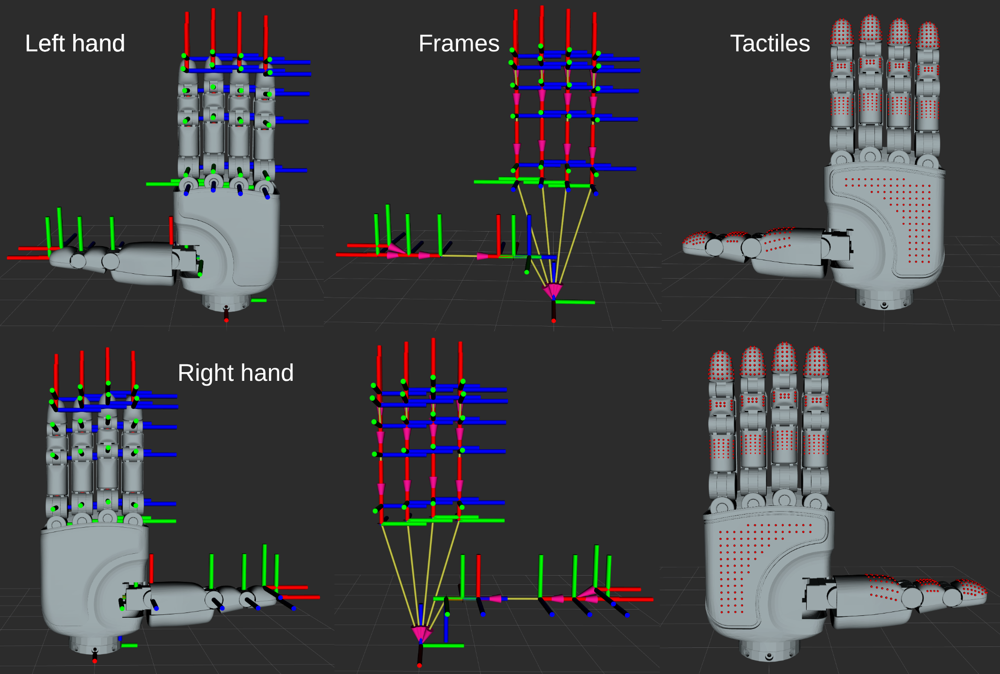
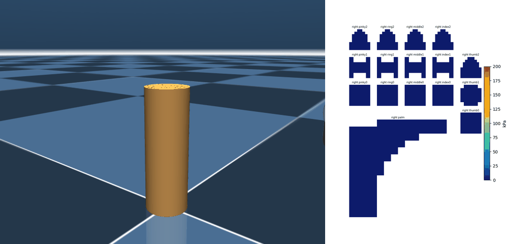

# Rysen Robotics Descriptions

Simulation assets for Rysen Robotics hardware: URDF, MJCF and USD models, the
tooling that generates and inspects them, and runnable example scenes. Every
model is available with or without the 619-point tactile array.

<p align="center">
  
</p>

| Robot | DoF | Tactile | Formats | Docs |
|---|---|---|---|---|
| Apex Hand | 21 | 619 points | URDF, MJCF, USD | [apex_hand/](apex_hand/README.md) |

## Repository Structure

```
description/
├── apex_hand/          Apex Hand assets
│   ├── urdf/
│   ├── mjcf/
│   ├── usd/
│   └── virtual_device/ SDK-facing MuJoCo virtual prototype
└── (future robots)
```

One directory per robot. Within a robot, one directory per format, and the
tooling and data that belong to a format live inside that format's directory
rather than beside it:

```
<robot>/
├── urdf/               source model + meshes + tactile data + tooling
├── mjcf/               generated + meshes + tooling + examples
├── usd/                generated + tooling + examples
└── virtual_device/     SDK-facing MuJoCo virtual prototype
```

`urdf/` is the source. `mjcf/` and `usd/` are both generated from it, each with
its own converter and examples; edit the source or the generator, then re-run
it, because hand edits to generated files are lost on the next run.

Per-robot details — which variant to load, mesh caveats, how each format is
generated — are in that robot's `urdf/`, `mjcf/`, `usd/` and `virtual_device/`
READMEs.

## Quick Start

### MuJoCo

Needs MuJoCo >= 3.10.

```bash
# without the tactile array
python3 -m mujoco.viewer --mjcf=apex_hand/mjcf/apex_hand_right/apex_hand_right.xml

# with the 619 tactile points
python3 -m mujoco.viewer --mjcf=apex_hand/mjcf/apex_hand_right/apex_hand_right_tactile.xml

cd apex_hand/mjcf
python3 examples/view_hand.py --side right              # no tactile
python3 examples/view_hand.py --side right --tactiles   # with tactile
python3 examples/grasp_cylinder.py --side right         # drive onto a cylinder, close, lift
```

Or load a model in Python — both variants load the same way:

```python
import mujoco

plain = mujoco.MjModel.from_xml_path(
    "apex_hand/mjcf/apex_hand_right/apex_hand_right.xml")           # no tactile

tactile = mujoco.MjModel.from_xml_path(
    "apex_hand/mjcf/apex_hand_right/apex_hand_right_tactile.xml")   # 619 tactile points
```

A recorded grasp — 3D view on the left, 619-point pressure map on the right:



The left hand is the mirror image; `apex_hand/mjcf/examples/record_grasp.py --side left`
records it.

### SDK virtual device

`apex_hand/virtual_device/` turns the MuJoCo model into a virtual hand that the
existing SDK can connect to without modification.

```bash
cd apex_hand/virtual_device
python3 -m pip install 'mujoco==3.10.0' 'numpy>=1.23,<2'
./start_simulation.sh right              # SDK connects to 127.0.0.2
./start_simulation.sh left               # SDK connects to 127.0.0.1
./start_simulation.sh dual               # both addresses
```

The control and feedback ports are the same as the physical hand: TCP `5856`
and `5857`. See [apex_hand/virtual_device/README.md](apex_hand/virtual_device/README.md)
for scene options and limitations.

### Isaac Sim

Needs Isaac Sim 6.2 with Isaac Lab 3.0; run the examples with that installation's
interpreter. Each hand loads as an articulation with the same 21 joints (27 in
the `_mount` variants, which add a six-joint base) and, in the tactile variants,
619 sensing spheres.

```bash
cd apex_hand/usd

python3 examples/view_hand.py --side right              # joint sliders
python3 examples/view_hand.py --side both --tactiles    # pair, with the array
python3 examples/grasp_cylinder.py --side right --tactiles   # grasp + pressure map
```

Each side ships four USD variants, from two independent choices: whether the 619
tactile bodies are emitted, and whether the root carries a six-joint mount.

| File | Mount | Tactile |
|---|---|---|
| `apex_hand_<side>.usd` | — | — |
| `apex_hand_<side>_tactile.usd` | — | 619 spheres |
| `apex_hand_<side>_mount.usd` | 6-DOF | — |
| `apex_hand_<side>_mount_tactile.usd` | 6-DOF | 619 spheres |

The bare files are the ones to attach to an arm: the hand is a floating
articulation and the caller supplies its own root joint. The `_mount` files add
three prismatic and three revolute joints, chained from the world to the palm
with position drives, so a standalone scene can hold and move the hand instead
of writing its root pose — a teleported root loses velocity and drags the
colliders through whatever they are touching. The examples load the `_mount`
ones.

`tools/urdf_to_usd.py` regenerates every variant from `urdf/`; the tactile
readout, collision cooking and GUI caveats are in
[`apex_hand/usd/README.md`](apex_hand/usd/README.md).

### URDF

Needs ROS 2 Humble on Ubuntu 22.04. The viewer shows the plain model by default;
`--tactile` switches to the variant carrying the 619 point frames.

```bash
python3 apex_hand/urdf/tools/rviz_viewer.py --side right            # no tactile
python3 apex_hand/urdf/tools/rviz_viewer.py --side right --tactile  # with tactile
```

## Contact

Questions, bug reports or feature requests: [support@rysenbot.com](mailto:support@rysenbot.com).

## License

See [LICENSE](LICENSE).
