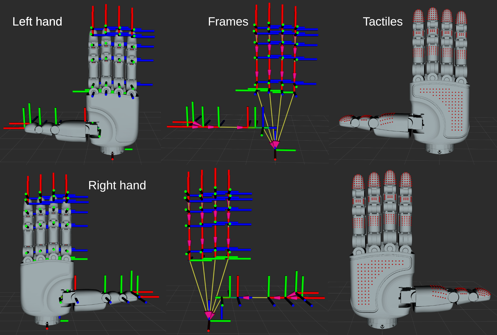
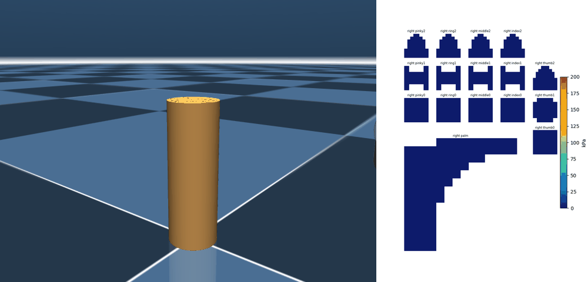
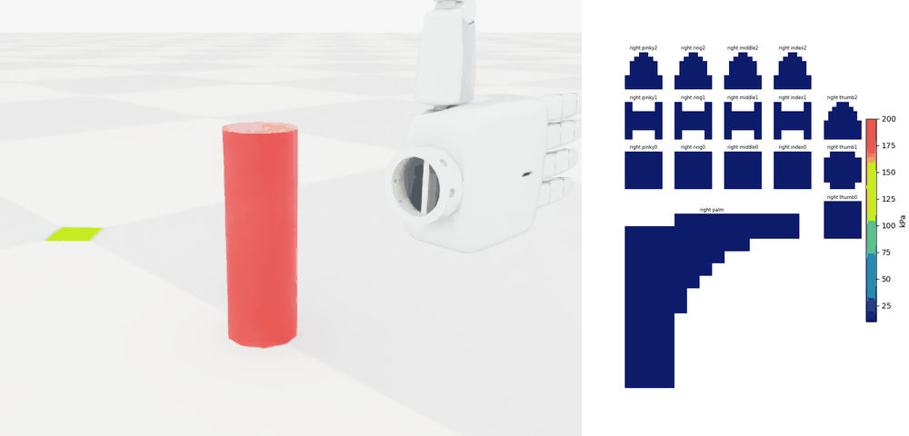

# Apex Hand

A 21-DoF dexterous hand with a 619-point tactile array, described in URDF and
generated from it into MJCF and USD.

<p align="center">
  
</p>

| | |
|---|---|
| Degrees of freedom | 21 revolute (5 thumb, 4 × 4 fingers) |
| Actuated joints | 16 of 21 — the other 5 mirror their paired joint |
| Tactile points | 619 per hand, 16 pad links |
| Formats | URDF, MJCF, USD |
| Sides | Left and right, mirror images |

## Structure

```
apex_hand/
├── urdf/                  Hand-written source of truth
│   ├── apex_hand_left/    URDF variants + meshes
│   ├── apex_hand_right/
│   ├── tactile/           Sensor data + the scripts that build the point frames
│   └── tools/             RViz viewer
├── mjcf/                  Generated from urdf/, do not edit by hand
│   ├── apex_hand_left/
│   ├── apex_hand_right/
│   ├── tools/             URDF -> MJCF converter
│   └── examples/          Runnable scenes
├── usd/                   Generated from urdf/, do not edit by hand
│   ├── apex_hand_left/    Four variants + manifest.json
│   ├── apex_hand_right/
│   ├── tools/             URDF -> USD converter
│   └── examples/          Runnable scenes
└── virtual_device/        SDK-facing MuJoCo virtual prototype
```

`urdf/` is the source; everything under `mjcf/` is generated by
`mjcf/tools/urdf_to_mjcf.py` and everything under `usd/` by
`usd/tools/urdf_to_usd.py`. Edit the generator, then re-run it — editing the
generated files is lost on the next run.

## Joint Parameters

Both hands share identical joint names and parameters: 21 revolute joints.
Thumb `j4` is coupled with `j3`, and the four fingers' `j3` is coupled with
`j2` (the angles are always equal). They are still modelled as independent
joints in the URDF; the coupling is enforced on the simulation and control
side. The SDK enums are defined in `sdk/include/rysen_apexhand_data.hpp`, and
values 0–20 follow the same order as the table.

| Joint | SDK Enum | lower (rad) | upper (rad) | effort (N·m) | velocity (rad/s) | Notes |
|---|---|---|---|---|---|---|
| thumb_j0 | `JOINT_ID_THUMB_J0` | 0 | 1.5707 (90°) | 1.2 | 6.9813 (400°/s) | |
| thumb_j1 | `JOINT_ID_THUMB_J1` | -0.1745 (-10°) | 1.0471 (60°) | 0.6 | 6.9813 (400°/s) | |
| thumb_j2 | `JOINT_ID_THUMB_J2` | 0 | 1.396 (80°) | 2.3 | 6.9813 (400°/s) | |
| thumb_j3 | `JOINT_ID_THUMB_J3` | -0.349 (-20°) | 1.396 (80°) | 1.0 | 6.9813 (400°/s) | |
| thumb_j4 | `JOINT_ID_THUMB_J4` | -0.349 (-20°) | 1.396 (80°) | 1.0 | 6.9813 (400°/s) | Coupled with j3 |
| index_j0 | `JOINT_ID_INDEX_J0` | -0.4363 (-25°) | 0.4363 (25°) | 2.0 | 6.9813 (400°/s) | |
| index_j1 | `JOINT_ID_INDEX_J1` | -0.349 (-20°) | 1.5707 (90°) | 3.2 | 6.9813 (400°/s) | |
| index_j2 | `JOINT_ID_INDEX_J2` | -0.0872 (-5°) | 1.7453 (100°) | 1.0 | 6.9813 (400°/s) | |
| index_j3 | `JOINT_ID_INDEX_J3` | -0.0872 (-5°) | 1.7453 (100°) | 1.0 | 6.9813 (400°/s) | Coupled with j2 |
| middle_j0 | `JOINT_ID_MIDDLE_J0` | -0.4363 (-25°) | 0.4363 (25°) | 2.0 | 6.9813 (400°/s) | |
| middle_j1 | `JOINT_ID_MIDDLE_J1` | -0.349 (-20°) | 1.5707 (90°) | 3.2 | 6.9813 (400°/s) | |
| middle_j2 | `JOINT_ID_MIDDLE_J2` | -0.0872 (-5°) | 1.7453 (100°) | 1.0 | 6.9813 (400°/s) | |
| middle_j3 | `JOINT_ID_MIDDLE_J3` | -0.0872 (-5°) | 1.7453 (100°) | 1.0 | 6.9813 (400°/s) | Coupled with j2 |
| ring_j0 | `JOINT_ID_RING_J0` | -0.4363 (-25°) | 0.4363 (25°) | 2.0 | 6.9813 (400°/s) | |
| ring_j1 | `JOINT_ID_RING_J1` | -0.349 (-20°) | 1.5707 (90°) | 3.2 | 6.9813 (400°/s) | |
| ring_j2 | `JOINT_ID_RING_J2` | -0.0872 (-5°) | 1.7453 (100°) | 1.0 | 6.9813 (400°/s) | |
| ring_j3 | `JOINT_ID_RING_J3` | -0.0872 (-5°) | 1.7453 (100°) | 1.0 | 6.9813 (400°/s) | Coupled with j2 |
| pinky_j0 | `JOINT_ID_PINKY_J0` | -0.4363 (-25°) | 0.4363 (25°) | 2.0 | 6.9813 (400°/s) | |
| pinky_j1 | `JOINT_ID_PINKY_J1` | -0.349 (-20°) | 1.5707 (90°) | 3.2 | 6.9813 (400°/s) | |
| pinky_j2 | `JOINT_ID_PINKY_J2` | -0.0872 (-5°) | 1.7453 (100°) | 1.0 | 6.9813 (400°/s) | |
| pinky_j3 | `JOINT_ID_PINKY_J3` | -0.0872 (-5°) | 1.7453 (100°) | 1.0 | 6.9813 (400°/s) | Coupled with j2 |

The SDK also provides anatomical alias enums with the same values:
`JOINT_ID_THUMB_CMC_ABD` = `JOINT_ID_THUMB_J0`, `JOINT_ID_INDEX_MCP_FLEX` =
`JOINT_ID_INDEX_J1`, and so on (CMC/MCP/PIP/DIP suffixes). The pinky's alias
prefix uses `LITTLE` (also `FINGER_ID_LITTLE` in `FingerId`).

## Tactile Array Layout

Each hand has **619 tactile points** across 16 tactile pad links. Per pad they
form a 2D array — 14×14 on the palm, down to 4×5 on the fingertips — so a
reading can be indexed by row and column rather than by a flat point number.

`urdf/tactile/remap.json` holds that mapping. Per-pad point counts, the raw
sensor file format and the scripts that generate the point frames are
documented in [`urdf/README.md`](urdf/README.md#tactile-points).

Both simulators read the array the same way — one 1 mm sphere per point, force
projected onto the point's normal. They agree on what the array is for (which
points are loaded, how the load spreads and moves) but not on absolute values:
the contact solvers and step sizes differ. Treat a reading as a relative signal,
not a calibrated pressure.

## Reporting Range

The array reports over a fixed range, like the sensor it stands in for:

| Quantity | Floor | Full scale |
|---|---|---|
| Per-point force | 0.1 N | 20 N |
| Per-point pressure | 10 kPa | 200 kPa |

Values outside the range are clipped rather than extrapolated: below the floor a
point reads nothing at all, above it saturates. This is applied to the readings
themselves, not just to the display, so the console output, the arrows and the
pressure map always show the same numbers. Pressure is derived from the clipped
force and then clipped again at its own ceiling, so the two ranges are enforced
independently.

Both visualizations follow those limits. An arrow appears at 0.1 N and stops
growing at 20 N, where it is 400 mm long. Its length is ∝ √force rather than
∝ force: over a 200:1 range a linear map turns weak points into 20 mm stubs
while strong ones reach a quarter of a metre, and the weak ones vanish behind
the hand. Direction is unaffected, only the length is compressed, so read an
arrow by whether it is there and roughly how long it is, not as a ruler. The
pressure map is blue from rest up to 10 kPa, and red at 200 kPa; a heavily
loaded grasp saturates most of its loaded cells, which is why the console line
reports the clipped peak.

## Choosing a URDF Variant

Each side ships two URDF files:

| File | Contents |
|---|---|
| `apex_hand_<side>.urdf` | Links, joints, meshes |
| `apex_hand_<side>_tactile.urdf` | Base model plus 619 point frames under the pad links |

Use the plain variant unless you need the tactile points. The extra frames are
massless reference points, not collision geometry.

## Choosing a USD Variant

Each side ships four USD files, from two independent choices: whether the 619
tactile bodies are emitted, and whether the root carries a six-joint mount.

| File | Mount | Tactile | Bodies | Joints |
|---|---|---|---|---|
| `apex_hand_<side>.usd` | — | — | 22 | 21 |
| `apex_hand_<side>_tactile.usd` | — | 619 spheres | 641 | 21 |
| `apex_hand_<side>_mount.usd` | 6-DOF | — | 28 | 27 |
| `apex_hand_<side>_mount_tactile.usd` | 6-DOF | 619 spheres | 647 | 27 |

Only the mount is a suffix: an unadorned file is the bare hand, the one to attach
to an arm or a teleoperation rig, where a root joint of its own would be in the
way. `_mount` adds three prismatic and three revolute joints chained from the
world to the palm, with position drives, so a standalone scene can hold and move
the hand without writing its root pose — a teleported root loses velocity and
drags the colliders through whatever it is touching. The `usd/examples/` scenes
load the `_mount` ones.

Unlike the URDF point frames, the tactile USD variants' sensing elements are real
rigid bodies: one 1 mm sphere per point, which is what lets PhysX report a
contact force per point. They carry the same collision geometry as the plain
variants. Details in [`usd/README.md`](usd/README.md).

## Quick Start

### RViz

Render the URDF (no colcon build needed):

```bash
python3 apex_hand/urdf/tools/rviz_viewer.py --side right --tactile
```

### MuJoCo

Run a grasp:

```bash
cd apex_hand/mjcf && python3 examples/grasp_cylinder.py --side right
```

Recorded with `mjcf/examples/record_grasp.py`, 9 s — 3D view on the left,
619-point pressure map on the right:



The left hand is the mirror image; `record_grasp.py --side left` records it.

### Isaac Sim

Load the hand (Isaac Sim 6.2 with Isaac Lab 3.0, run by that install's
interpreter):

```bash
cd apex_hand/usd
python3 examples/view_hand.py --side right --tactiles
python3 examples/grasp_cylinder.py --side right --tactiles
```

The grasp drives onto a cylinder, closes, lifts it — showing the force arrows in
the viewport and the 619-point pressure map in a second window, the same two
views as the MuJoCo demo. Vanilla Isaac Sim's interpreter has no GUI toolkit for
matplotlib, so that window runs in its own process; without a display the run
still reports the same readings on the console (`--viz none`).

Recorded with `usd/examples/record_grasp.py`, 9 s — 3D view on the left,
619-point pressure map on the right:



## More

- [`urdf/README.md`](urdf/README.md) — URDF assets, tactile points, mesh caveats, RViz
- [`mjcf/README.md`](mjcf/README.md) — MJCF variants and the generator
- [`usd/README.md`](usd/README.md) — USD variants, tactile readout, PhysX settings
- [`virtual_device/README.md`](virtual_device/README.md) — SDK-facing MuJoCo virtual prototype

## Contact

Questions, bug reports or feature requests: [support@rysenbot.com](mailto:support@rysenbot.com).
